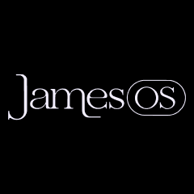
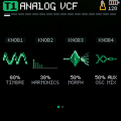
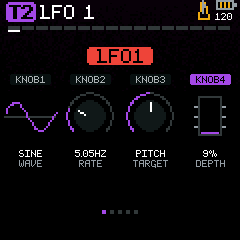
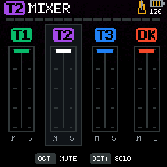
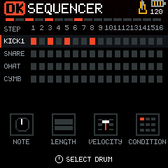

# JamesOS

<p align="center">
  
</p>

JamesOS is community firmware for the M-VAVE FM-1, built on Dinghy and the Felucca platform with SLOOP contributions. It adds synth engines, drum kits, sequencing and performance controls. The project is independent of the hardware manufacturer.

JamesOS is a Gjelly project by Aaron Grando (a.k.a. James Os).

This repository builds two products from one source tree: JamesOS for the FM-1, the default, and JamesOS-K, a port for the M-VAVE SMK-37 Pro. The rest of this page describes JamesOS on the FM-1 unless a section says otherwise; see [Products](#products).

<table>
  <tr>
    <td align="center"><br>Sound controls</td>
    <td align="center"><br>LFO</td>
  </tr>
  <tr>
    <td align="center"><br>Mixer</td>
    <td align="center"><br>Drum sequencer</td>
  </tr>
</table>

The screenshots above are illustrative; compare release graphics with the exact firmware package before publication.

## What it does

- Three synth tracks and a four-lane drum kit.
- 24 Plaits engines and 128 starting sounds.
- Drum kits synthesized with the Plaits percussion models.
- A sequencer with patterns, and a pattern arranger: a timeline of blocks with bar lengths and loops.
- Effects per track (drive, delay and modulation) and a global reverb with a per-track send. Delay times and the reverb pre-delay can follow the tempo.
- Two patch slots per track, LFOs and a global LFO.
- Voice modes (glide, LPG gate) in the HOME deep menu.
- Projects saved in 12 named slots, with import and export through the browser Editor (FM-1 only).
- The HD interface on both products.
- A screen-reader protocol adapter ([docs/SCREEN-READER.md](docs/SCREEN-READER.md)).

## Status

This tree is JamesOS 1.0b, build 3083 (identities `FM-1_9673083` and `SMK-37 Pro_9653083`). The host test suite is the main regression check; see [Build and test](#build-and-test). Release notes are in [docs/RELEASE-1.0b.md](docs/RELEASE-1.0b.md) and the changelog is in [docs/CHANGELOG.md](docs/CHANGELOG.md).

Memory budgets, measured on build 3082 (3083 should be within a few hundred bytes):

| Budget | FM-1 | SMK-37 Pro |
| --- | --- | --- |
| Application image | 497,072 of 581,564 B | 509,228 of 619,520 B |
| `.data` + `.bss` | 84,848 of 98,304 B | 85,776 of 98,304 B |
| Designated pool | 342,960 of 344,064 B | 343,344 of 344,064 B |
| RAM code | 31,328 of 32,512 B | 32,076 of 32,512 B |

Reading the DX7 banks from flash recovered about 12 KB of data memory on both products.

## Products

| Product | Device | Build selection | Status |
| --- | --- | --- | --- |
| JamesOS | M-VAVE FM-1 | `tools/build.py --target fm1` | Build 3083. |
| JamesOS-K | M-VAVE SMK-37 Pro | `tools/build.py --target smk37` | Build 3083. Its button layout is described in [docs/SMK37-PORT.md](docs/SMK37-PORT.md). |

## Projects and compatibility

Projects use session format v20 inside project envelope v6; envelope v5 loads with an empty arrangement. Projects saved by 1.0a are not loaded directly and need conversion through the Editor. Older firmware rejects newer projects rather than discarding the settings it cannot store.

## Source layout

- `firmware/` contains the firmware, loader, hardware layer and synthesis libraries.
- `assets/` contains inputs required to regenerate firmware data.
- `tools/` contains build, development and recovery tools.
- `tests/` contains host-side regression tests and their fixtures.
- `docs/` contains design notes, format specifications and legal notices.

## Build and test

The device build requires the JieLi Linux toolchain and the AC79 SDK tag pinned by `tools/build.py`; see `tools/get_toolchain.sh`. Set `JIELI_TOOLCHAIN` to the toolchain directory and `AC79_SDK` to the SDK checkout (`--sdk` overrides `AC79_SDK`). On macOS, Docker is required. `--build-number` sets the paired build number that prefixes the instrument identity. The flag set below is the one recorded for the current candidate (build 3083 at the time of writing); each candidate records its exact command in BUILD-REPRODUCIBILITY.txt in its source archive. Build the FM-1 distribution configuration with:

```sh
python3 tools/build.py --pattern-device-candidate --app-opt Oz --build-number NNNN --diagnostics distribution --define RV2_LINE_STRUCT=1 --define BR_MODEL_MOD_EXPERIMENT=1 --define FM1_PATTERN_DELETE_EXPERIMENT=1 --define FM1_PATTERN_DELETE_PROTOCOL_EXPERIMENT=1 --define FM1_PATTERN_RAW_EXPORT_EXPERIMENT=1 --define BR_ADAPTIVE_POLY=1
```

and the SMK-37 Pro configuration (which omits the FM-1-only raw export) with:

```sh
python3 tools/build.py --target smk37 --pattern-device-candidate --app-opt Oz --build-number NNNN --diagnostics distribution --define RV2_LINE_STRUCT=1 --define BR_MODEL_MOD_EXPERIMENT=1 --define FM1_PATTERN_DELETE_EXPERIMENT=1 --define FM1_PATTERN_DELETE_PROTOCOL_EXPERIMENT=1 --define BR_ADAPTIVE_POLY=1
```

These commands build the HD interface, the only interface of both products, into the plain output directories (for example `build/pattern-device-candidate-distribution/`, or `build/pattern-device-candidate-distribution-smk37/` for `--target smk37`); any release built that way must be accompanied by `docs/legal/HD-FONT-NOTICE.md`. `--ui-hd` is accepted and changes nothing; `--ui-standard` is an error.

FM-1 device candidates (`--pattern-device-candidate`) include stopped-transport polyphony by default; `--polyphony` is accepted and changes nothing. `--no-polyphony` builds without it into a separate `-nopoly` output directory (FM-1) or the same directory with `-DBR_CAP_POLY=0` (SMK-37 Pro). Builds that are not device candidates never include polyphony.

The distribution configuration excludes development-only controls, exposed telemetry, profiling and optional crash sidecar capture. The physical MIDI input retains small internal activity counters. It retains operational timing, safety, fault and recovery paths and rejects optional profiling and test modes. Build output includes `build-settings.json` identifying the selected configuration. See `docs/DIAGNOSTICS.md` for details.

Native host tests use a C/C++ compiler and Python. Run one runner, for example `python3 tests/run_global_timing.py`, which builds the host DSP objects and runs a timing regression without accessing hardware. Run the whole suite for one configuration with `python3 tests/run_suite.py --config fm1` (also `fm1-nopoly`, `smk37`, `smk37-nopoly`); never run two suites in one tree, because they share `build/host`. See `tests/README-SPEED.md`. Generated outputs belong in `build/`.

Installing unofficial firmware can risk project data or make the device unresponsive. Always back up saved work before switching firmware. Hardware compatibility, upgrade and recovery paths remain under active validation.

## Licences and credits

JamesOS firmware code is GPL-3.0-only; see `LICENSE`. The platform derives from [Felucca](https://github.com/hugelton/Felucca) by Leo Kuroshita and Hügelton Instruments, with [SLOOP](https://github.com/isod89/sloop-fm1) contributions, and [Dinghy](https://github.com/zvenson/dinghy) by zvenson. Plaits, Braids and stmlib retain their MIT licences in their upstream directories. JamesOS-K's SMK-37 Pro input and display transport derive from M. Geisler's Felucca SMK-37 port (GPL-3.0-only). Component notices and the JieLi SDK licence are in `docs/legal/`.
