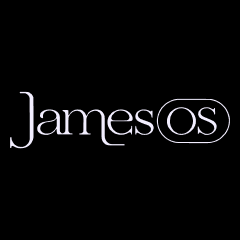
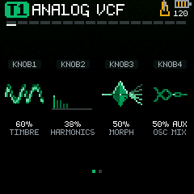
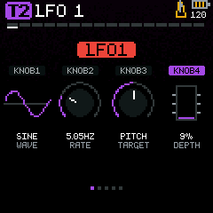
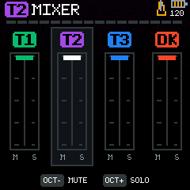
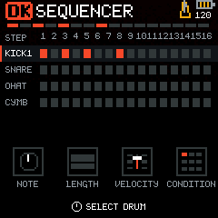

# JamesOS

<p align="center">
  
</p>

JamesOS is community firmware for the M-VAVE FM-1, built on Dinghy and the Felucca platform with SLOOP contributions. It adds synth engines, drum kits, sequencing and performance controls. The project is independent of the hardware manufacturer.

JamesOS is a Gjelly project by Aaron Grando (a.k.a. James Os).

<table>
  <tr>
    <td align="center"><br>Sound controls</td>
    <td align="center"><br>LFO</td>
  </tr>
  <tr>
    <td align="center"><br>Mixer</td>
    <td align="center"><br>Drum sequencer</td>
  </tr>
</table>

Screens shown above were rendered from the 1.0a firmware source in the host emulator.

Release candidates are identified by source tags and matching firmware packages. Hardware compatibility, update and recovery coverage are documented for each candidate.

The **1.0a alpha** release now uses build 2108. It adds input from the FM-1’s 3.5 mm MIDI IN jack alongside USB MIDI. Both use the same track and drum-lane channel settings; `OFF` disables input and suppresses that destination’s keyboard MIDI output. The external clock setting accepts clock and transport from either input. Use one clock source at a time.

Upstream keeps two build 2108 packages in its `releases/` directory (tag `v1.0a-2108`). This fork no longer tracks them in the tree; its releases are on the GitHub Releases page (see Releases below), and the installer fetches the combined package from the last commit that held it, checked against its SHA-256:

- `JamesOS-1.0a-build-2108.fwsc` is the application update package, installed and restarted on one FM-1.
- `JamesOS-1.0a-build-2108-from-v15.fwsc` includes the 396 MHz boot configuration. Its boot area and official loader match the hardware-tested 2104 combined package, and its application matches the installed 2108 package. The exact combined 2108 package has not been tested on hardware.

On the tested FM-1 (flash ID `0x856014`), the owner confirmed physical MIDI note playback and external clock on build 2108. Note release and channel OFF were confirmed on the earlier 2106 test build. A diagnostic-build test with an external sequence reported no audio overruns during a short run. Updates completed with a MIDI cable connected, but incoming traffic during those updates was not measured. One earlier test startup entered USB rescue; two subsequent starts with the cable connected were normal. Other hardware, interrupted updates and prolonged MIDI workloads remain unverified. Switching firmware can overwrite saved data.

The combined package incorporates material derived from M-VAVE's V14 firmware; its redistribution terms remain to be confirmed. Its boot area retains the CRC mismatch reported by the independent package validator for the prior combined package; the same boot bytes were verified after a 2104 hardware installation.

On a Mac that previously recognized the device as JamesOS, the MIDI name may remain cached until updated in Audio MIDI Setup.

To reproduce the 2108 combined package, provide a separately obtained official V14 firmware package (SHA-256 `7e7b6d260163cdf9d716f7fab44f19be600edeffcd390de74370b83c917fd0c6`):

```sh
python3 tools/build_v15_install_package.py --app /path/to/JamesOS-1.0a-build-2108.fwsc --v14 /path/to/official-v14.fwsc --output /tmp/jamesos-2108-from-v15.fwsc
```

The combined package SHA-256 is `75c0ea9251db9ab08d3886bfc784a7ddd1638a679257b16f714975cff597c729`; the standard package SHA-256 is `e597224b7845a6f9cbef30016f5208fe1e8e7cee1647f1c30fa8ff4675f54942`.

## MIDI output

This fork sends what the FM-1 plays to other gear over USB MIDI, after SLOOP:

- The sequencer's and the arp's notes go out on each track's channel (`T1 CH`…`T3 CH`), and the drum lanes' hits on theirs (`D1 CH`…`D4 CH`). The keys go out on the same channels. `OFF` sends nothing for that track or lane. Notes received over MIDI are not sent back.
- `MIDI CLOCK` on the mixer's MIDI page is `OFF`, `RECEIVE` (follow clock and transport from USB or the MIDI IN jack) or `SEND`. With `SEND` the FM-1 is the clock master: 24 pulses a beat at its tempo, also while stopped, with START as the sequencer starts and STOP as it stops.

The setting is saved with the project. A project saved with `SEND` is not accepted by JamesOS builds without this feature. These changes pass the host tests (`python3 tests/run_midi_seq_out.py`) and have not been tested on hardware.

## Web installer

`web/` holds a browser installer after SLOOP's (Web MIDI: Chrome or Edge on a computer, Chrome on Android). The Release workflow publishes it with GitHub Pages (Settings → Pages → Source: GitHub Actions), so the page always installs the latest release. The page:

- updates an FM-1 that runs JamesOS to this build;
- installs the released build 2108 from-V15 package on an FM-1 that runs the official firmware, then updates it in a second pass;
- returns an FM-1 to the official V15 from the unmodified `FM-1.fwsc` the user selects, which is how an FM-1 on SLOOP gets here.

`node web/test_web.mjs` runs its checks against a simulated FM-1 (after `python3 web/base_package.py build/base/jamesos-base-from-v15.fwsc` for the package checks). The page has not been used with hardware.

## Releases

Run **Actions → Release → Run workflow** on `main`. Leave the tag empty and the workflow reuses a release tag already on that commit, or names the next build: `v1.0a-midi-2150`, then `2151`, and so on. The build number is also the package identity (`FM-1_9262150`). A tag typed in is released at its own commit when it exists, and created on the run's commit when it does not.

The workflow runs the host tests, builds and validates the firmware with that identity, and only then pushes the tag and publishes the release with the package, upstream's 2108 base and their SHA-256 sums. For a run on the default branch it then publishes the installer page from the same files. Pushes to `main` and `claude/**` branches still run the tests and a test build (identity `FM-1_9262149`), but they no longer change the page.

## Source layout

- `firmware/` contains the firmware, loader, hardware layer and synthesis libraries.
- `assets/` contains inputs required to regenerate firmware data.
- `tools/` contains build, development and recovery tools.
- `tests/` contains host-side regression tests and their fixtures.

## Build and test

The device build requires the JieLi Linux toolchain and the AC79 SDK tag pinned by `tools/build.py`; see `tools/get_toolchain.sh`. Set `JIELI_TOOLCHAIN` to the toolchain directory and `AC79_SDK` to the SDK checkout. On macOS, Docker is required. The following commands select development and distribution configurations. Build the development configuration with:

```sh
python3 tools/build.py --pattern-device-candidate --app-opt Oz --product FM-1_9262013 --diagnostics development --sdk "$AC79_SDK"
```

Build the distribution configuration with:

```sh
python3 tools/build.py --pattern-device-candidate --app-opt Oz --product FM-1_9262108 --diagnostics distribution --sdk "$AC79_SDK"
```

The distribution configuration excludes development-only controls, exposed telemetry, profiling and optional crash sidecar capture. The physical MIDI input retains small internal activity counters. It retains operational timing, safety, fault and recovery paths and rejects optional profiling and test modes. Build output includes `build-settings.json` identifying the selected configuration. See `docs/DIAGNOSTICS.md` for details.

Native host tests use a C/C++ compiler and Python. For example, `python3 tests/run_global_timing.py` builds the host DSP objects and runs a timing regression without accessing hardware. Generated outputs belong in `build/`.

Installing unofficial firmware can risk project data or make the device unresponsive. Hardware compatibility, upgrade and recovery paths remain under active validation.

## Licences and credits

JamesOS firmware code is GPL-3.0-only; see `LICENSE`. The platform derives from [Felucca](https://github.com/hugelton/Felucca) by Leo Kuroshita and Hügelton Instruments, with [SLOOP](https://github.com/isod89/sloop-fm1) contributions, and [Dinghy](https://github.com/zvenson/dinghy) by zvenson. Plaits, Braids and stmlib retain their MIT licences in their upstream directories. Component notices and the JieLi SDK licence are in `docs/legal/`.
